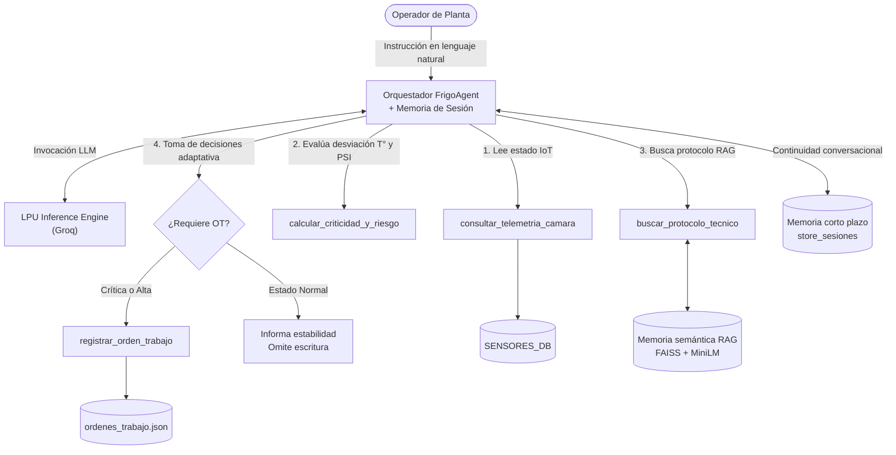

# FrigoAgent 🧊 — Agente autónomo de mantenimiento para refrigeración industrial

**Asignatura:** ISY0101 – Ingeniería de Soluciones con IA · Evaluación Parcial N°2
**Institución:** Duoc UC · Sede San Bernardo
**Integrantes:** Sergio Andrés Ortiz Acevedo · [Nombre compañero/a]

---

## 1. Descripción

**FrigoAgent** es un agente funcional que automatiza el flujo de supervisión y mantenimiento de cámaras frigoríficas. Un operador de planta le da una instrucción en lenguaje natural y el agente:

1. **Consulta** la telemetría IoT de las cámaras (temperatura, presión, humedad, puertas).
2. **Razona** sobre la desviación térmica y de presión para clasificar el riesgo.
3. **Recupera** el protocolo técnico correspondiente desde los manuales (RAG).
4. **Decide y escribe**: genera una Orden de Trabajo (OT) solo cuando la prioridad es ALTA o CRÍTICA; si la cámara está normal, informa estabilidad y no escribe nada.

Además mantiene **memoria de sesión**, por lo que el operador puede dar seguimiento a alertas previas sin repetir información.

## 2. Arquitectura


> 📌 Guarda el diagrama como `docs/arquitectura.png` para que se vea aquí. Versión equivalente en Mermaid:



### Componentes

| Componente | Tecnología | Rol |
|---|---|---|
| Framework de agentes | LangChain (`langchain-core`, `langchain-community`) | Definición de herramientas (`@tool`), mensajes y Tool-Calling |
| Motor cognitivo (LLM) | Groq (LPU) · `openai/gpt-oss-120b` (`temperature=0.1`, `max_tokens=600`) | Razonamiento, planificación y selección de herramientas |
| Memoria semántica (largo plazo) | FAISS + `paraphrase-multilingual-MiniLM-L12-v2` (HuggingFace, local) | Recuperación de protocolos, políticas SLA e historial |
| Memoria de sesión (corto plazo) | Diccionario `store_sesiones` indexado por `session_id` | Conserva `SystemMessage`, `HumanMessage`, `AIMessage` y `ToolMessage` |
| Orquestador | Clase `OrquestadorFrigoAgent` | Ciclo ReAct / Tool-Calling (máx. 8 iteraciones) |
| Persistencia | `ordenes_trabajo.json` | Almacén de las órdenes de trabajo |

## 3. Herramientas del agente

| Herramienta | Tipo | Descripción |
|---|---|---|
| `consultar_telemetria_camara` | Consulta | Lee los sensores simulados (`SENSORES_DB`) de `CAM-01`, `CAM-02`, `CAM-03` o `TODAS`. |
| `calcular_criticidad_y_riesgo` | Razonamiento | Calcula la desviación térmica y evalúa la presión para devolver riesgo y prioridad sugerida. |
| `buscar_protocolo_tecnico` | Recuperación semántica (RAG) | Busca en FAISS los `k=2` fragmentos más relevantes (manuales, SLA, historial). |
| `registrar_orden_trabajo` | Escritura | Crea un ticket `OT-2026-XXX` con fecha, cámara, prioridad, diagnóstico y plan de acción. |

### Reglas de criticidad

| Condición | Prioridad | SLA |
|---|---|---|
| Desviación térmica ≥ 10 °C **o** presión ≥ 150 PSI | `CRITICA` | < 30 min |
| Desviación térmica ≥ 5 °C **o** presión < 50 PSI | `ALTA` | < 2 h |
| Otro caso | `PREVENTIVA` | 48 h |

## 4. Memoria y recuperación de contexto

- **Memoria de corto plazo (IE3):** `store_sesiones[session_id]` guarda todo el historial de mensajes de la conversación. Permite instrucciones como *"procesa la otra cámara pendiente"* sin volver a consultar los sensores.
- **Memoria de largo plazo / semántica (IE4):** los documentos corporativos (protocolos `F-101` y `F-204`, política `SLA-01` y bitácora `HIST-01`) se vectorizan con MiniLM (384 dimensiones) y se indexan en FAISS. El agente recupera por similitud semántica el protocolo que corresponde a los síntomas detectados.

## 5. Planificación y toma de decisiones (IE5)

El esquema de planificación está definido en el *system prompt* y lo ejecuta el ciclo de orquestación:

1. **Consulta:** obtiene la telemetría real.
2. **Razonamiento:** calcula criticidad y riesgo si hay anomalías.
3. **Recuperación semántica:** busca el protocolo aplicable.
4. **Decisión y escritura:** si el estado es NORMAL (ej. `CAM-02`), informa y **no** genera OT; si la prioridad es ALTA o CRÍTICA, registra la OT con el plan del manual.

## 6. Estructura del repositorio

```
.
├── evaluacion2Sergio_Ortiz.ipynb   # Notebook con el agente completo (código + pruebas)
├── docs/
│   └── arquitectura.png            # Diagrama de orquestación
├── ordenes_trabajo.json            # Se genera al ejecutar el notebook
└── README.md
```

## 7. Ejecución

### Requisitos
- Cuenta en [Groq Console](https://console.groq.com) y una **API Key** (`gsk_...`).
- Google Colab (recomendado) o Python 3.10+ con Jupyter.

### Pasos
1. Abre `evaluacion2Sergio_Ortiz.ipynb` en Google Colab (o Jupyter).
2. Ejecuta las celdas en orden. La primera instala las dependencias:
```bash
   pip install -q -U langchain langchain-core langchain-community langchain-groq \
       langchain-huggingface sentence-transformers faiss-cpu
```
3. Cuando lo pida, ingresa tu `GROQ_API_KEY` (se solicita con `getpass`; **no se guarda en el repositorio**).
4. Las celdas siguientes inicializan la base IoT simulada, indexan la memoria semántica, definen las herramientas, crean el agente y ejecutan las pruebas.

> ⚠️ El plan gratuito de Groq tiene límites de tokens por minuto. Por eso el modelo usa `max_tokens=600` y el notebook espera 15 s entre pruebas.

## 8. Pruebas y evidencia

Sesión `turno_planta_01` con dos turnos consecutivos:

| Prueba | Instrucción | Comportamiento observado |
|---|---|---|
| **1. Barrido general** | Revisar todas las cámaras y actuar solo sobre la más crítica | Consulta las 3 cámaras, calcula el riesgo de cada una y recupera los protocolos F-101 / F-204. |
| **2. Continuidad de memoria** | *"Procesa la otra cámara que tenía problemas pendientes"* | Sin que se mencione el ID, retoma el contexto del turno anterior, registra la OT y entrega un informe por cámara. |

Resultado persistido en `ordenes_trabajo.json`:

```json
{
  "ticket_id": "OT-2026-001",
  "camara_id": "CAM-03",
  "prioridad": "CRITICA",
  "estado": "ASIGNADO_A_TERRENO"
}
```

`CAM-02` (2.8 °C, 68 PSI) se clasifica como estable y no genera OT.

## 9. Decisiones de diseño

- **LangChain + Tool-Calling:** desacopla el razonamiento del LLM de las funciones operativas, lo que facilita agregar herramientas sin reescribir el agente.
- **Groq (LPU):** baja latencia de inferencia, útil en un contexto de emergencia operativa.
- **FAISS + embeddings locales:** búsqueda semántica sin infraestructura externa ni dependencia de cuotas de API para vectorizar.
- **Cálculo determinista en una herramienta:** los umbrales de riesgo no los "adivina" el LLM; los calcula `calcular_criticidad_y_riesgo`, lo que da trazabilidad.
- **Orquestador propio:** el bucle de Tool-Calling está implementado explícitamente, lo que permite controlar la memoria de sesión y el límite de iteraciones.

## 10. Limitaciones y trabajo futuro

- Los sensores y la base de conocimiento son **simulados** (no hay conexión a IoT real).
- La memoria de sesión vive en RAM y se pierde al reiniciar el entorno.
- Posibles mejoras: persistir sesiones, conectar telemetría real (MQTT/API), validar la prioridad de la OT contra la herramienta de criticidad y ampliar el corpus de manuales.

## 11. Uso de IA

Se utilizó **Google Gemini** como asistente de apoyo para el código en Google Colab. Todo el contenido fue revisado y validado por el equipo.

## 12. Referencias

- Google. (2026). *Gemini* [Modelo de lenguaje grande]. https://gemini.google.com/
- Groq. (2026). *GroqCloud API Documentation & LPU Inference Engine*. https://console.groq.com/docs
- LangChain. (s. f.). *LangChain documentation*. https://python.langchain.com/

